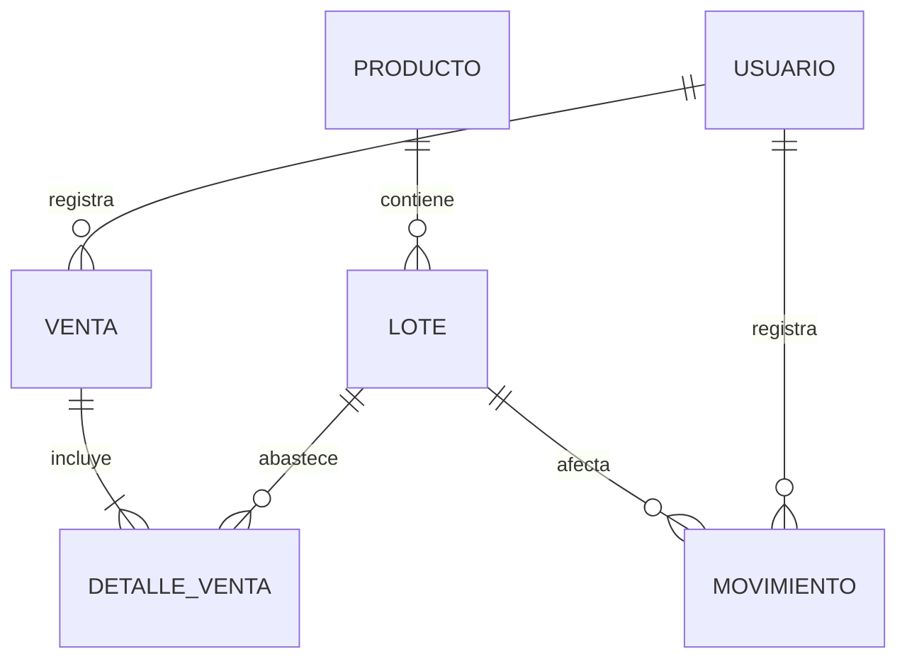

# Diseño y arquitectura

## Demo web

El navegador recibe el HTML y, según la versión publicada, los estilos, recursos y scripts. GitHub Pages sirve esos archivos; no ejecuta un backend. Los estados visuales preparados no equivalen a operaciones ejecutadas. Si la demo usa `localStorage`, los datos se conservan en ese navegador y no se comparten con otros usuarios.

## Modelo lógico propuesto

- **Administración:** catálogo, lotes, ajustes, alertas, reportes y gestión de usuarios según alcance.
- **Ventas y Dispensación:** consulta de existencias, vencimientos y registro de ventas.

El diagrama documenta el diseño del sistema, no prueba que la demo tenga una base de datos.
