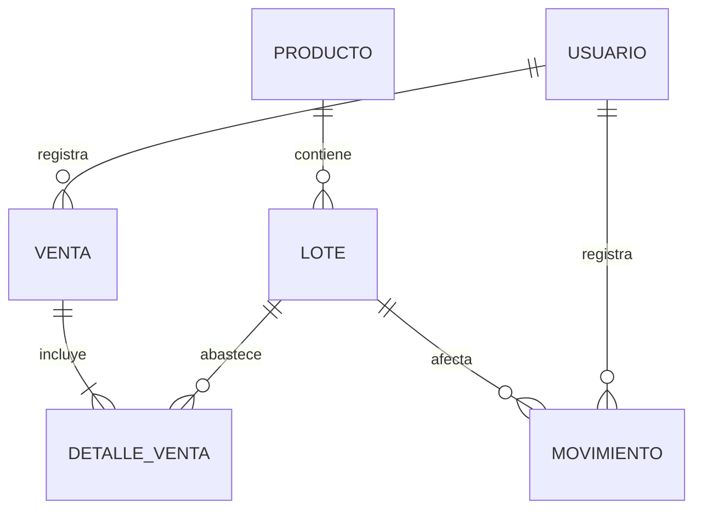

# Diseño y arquitectura

## Demo web

El navegador recibe el HTML y no ejecuta un backend, los estados visuales no son operaciones reales ejecutadas, por lo tanto todas las interacciones y cambios que se hacen quedan guardadas solo en el navegador.

## Modelo lógico propuesto

- **Administración:** catálogo, lotes, ajustes, alertas, reportes y gestión de usuarios según alcance.
- **Ventas y Dispensación:** consulta de existencias, vencimientos y registro de ventas.

El diagrama documenta el diseño del sistema.
