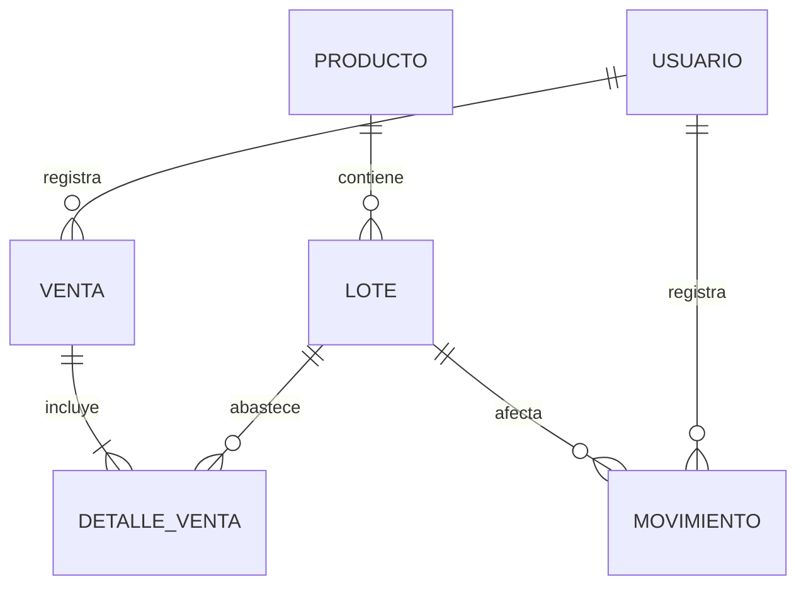
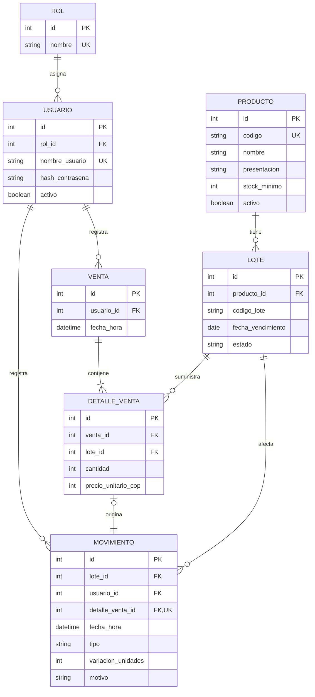

# Diseño y arquitectura

## Demo web

El navegador recibe el HTML y no ejecuta un backend, los estados visuales no son operaciones reales ejecutadas, por lo tanto todas las interacciones y cambios que se hacen quedan guardadas solo en el navegador.

## Modelo lógico propuesto

- **Administración:** catálogo, lotes, ajustes, alertas, reportes y gestión de usuarios según alcance.
- **Ventas y Dispensación:** consulta de existencias, vencimientos y registro de ventas.

El diagrama documenta el diseño del sistema.

# Modelo entidad–relación — Droguería El Nuevo Edén

**Proyecto:** Sistema web de inventarios y ventas · Magangué, Bolívar  
**Alcance:** Diseño lógico del MVP que sirve de referencia para el prototipo web en HTML y para una implementación con base de datos.

## Diagrama

**Lectura:** `PK` = clave primaria; `FK` = clave foránea; `UK` = valor único. Una venta confirmada tiene uno o más detalles. Cada detalle corresponde a un lote y genera un movimiento de salida. Las entradas y ajustes no tienen detalle de venta asociado.

## Reglas del modelo

| Área | Regla |
| --- | --- |
| **Acceso** | Cada cuenta tiene un rol asignado. **Administración** gestiona catálogo, entradas, ajustes, usuarios y reportes generales. **Ventas y Dispensación** consulta existencias y vencimientos, registra ventas y revisa las del turno. |
| **Productos y lotes** | Cada lote pertenece a un producto. La combinación `producto_id + codigo_lote` es única. Los saldos se expresan en una unidad de inventario definida por presentación, sin mezclar cajas y tabletas. |
| **Existencias** | El saldo por lote se calcula sumando sus movimientos. Las entradas suman; las ventas restan; los ajustes se registran con motivo y responsable. No se permiten saldos negativos. |
| **Ventas** | Se validan cantidad, saldo y vigencia del lote. Si una venta usa dos lotes, se registra un detalle por lote. La venta, sus detalles y las salidas se guardan juntos o se revierten juntos. Cada salida de venta debe coincidir con el lote y la cantidad de su detalle. |
| **Vencimientos y alertas** | Se prioriza el lote apto más próximo a vencer (FEFO). Las alertas se calculan por fecha de vencimiento y por saldo disponible inferior al mínimo del producto. No se ofrece para venta un lote vencido o no apto. |
| **Reportes en COP** | El importe de cada detalle es `cantidad × precio_unitario_cop`. El total de la venta suma sus detalles. Los reportes aplican un rango de fechas y usan el precio guardado en cada detalle, no el precio vigente del catálogo. |

Los **saldos, alertas y reportes** se obtienen de los registros anteriores; no requieren tablas propias en este alcance. El diagrama documenta el diseño de la base de datos. La autenticación, la persistencia y los permisos por rol se verifican aparte mediante pruebas de la implementación.

